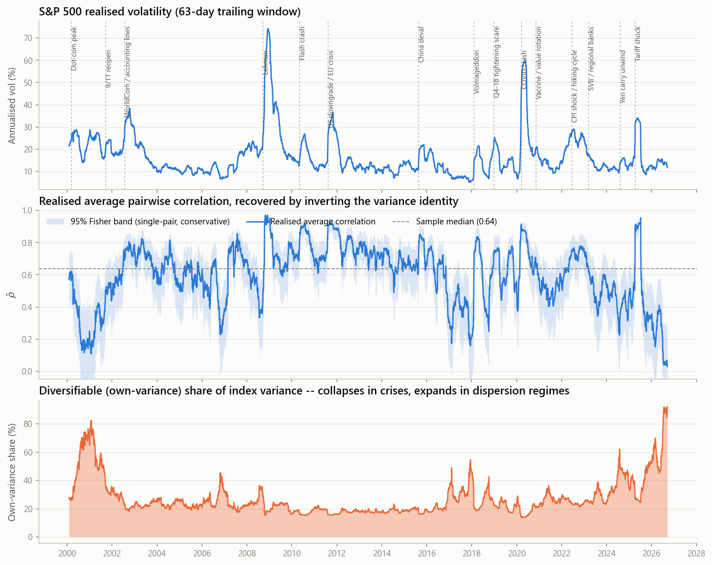
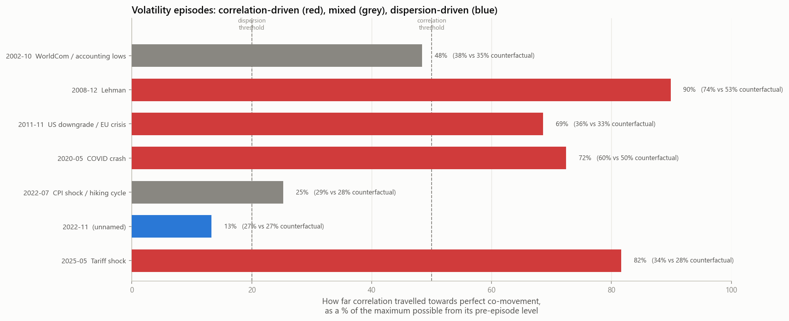
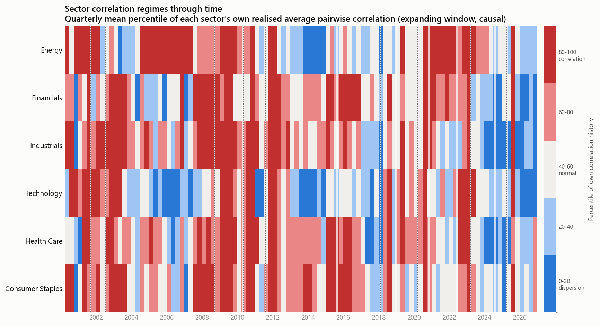
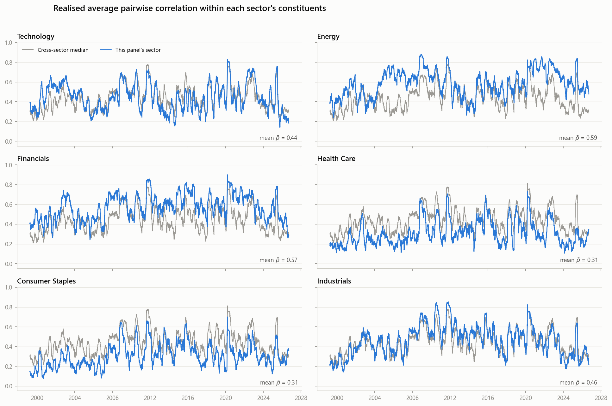

# Volatility dispersion and correlation regimes in the S&P 500

When index volatility rises, is it because the constituents got more volatile,
or because they started moving together? I tried to answer that with realised
data only (no options, no factor model, no strategy), first for the S&P 500 as a
whole and then inside six sectors, over 1999–2026.

This is a descriptive study. There is no backtest and nothing here is a trading
recommendation.

## Data

- **Index:** SPY, 1999-01-04 to 2026-09-15.
- **Index constituents:** the SPDR sector ETFs (`XLK`, `XLF`, `XLE`, …). There
  are 9 at the start; `XLRE` joins in 2015-10 and `XLC` in 2018-06, giving 11.
- **Sector panels:** 116 large-cap single names across six sectors (Energy,
  Financials, Industrials, Technology, Health Care, Consumer Staples), 13–20 names
  per sector, as an unbalanced panel.
- **VIX term structure:** VIX and VIX3M from CBOE, with VIX3M extended back to
  2007-12 using FRED's `VXVCLS` (the same index under its older name).

One thing to be clear about: at the index level the "constituents" are sector
ETFs, not stocks. So the index-level correlation is the correlation *between
sectors*, and the index-level "own variance" share measures diversification
*across sectors*. Single-name correlations only appear in the sector-level
analysis.

## Method

**The identity.** If the index return is a weighted sum of constituent returns,
$R_{\text{index}} = \sum_i w_i R_i$, then its variance splits exactly into an
own-variance term and a cross term:

$$\sigma_{\text{index}}^2 = \sum_i w_i^2 \sigma_i^2 + \sum_{i \neq j} w_i w_j \rho_{ij}\sigma_i\sigma_j .$$

This only holds exactly for simple returns, not log returns (the log of a
weighted sum isn't the weighted sum of logs), so I use simple returns
throughout. Replacing the $\rho_{ij}$ with a single average $\bar\rho$ and
solving gives

$$\bar\rho = \frac{\sigma_{\text{index}}^2 - \sum_i w_i^2 \sigma_i^2}{\sum_{i\neq j} w_i w_j \sigma_i \sigma_j}.$$

Everything on the right is observable from returns. The $\bar\rho$ you get back is
a covariance-weighted average of the pairwise correlations, not the simple mean of
the correlation matrix; the two can differ a lot when weights and volatilities
are uneven.

**Why correlation sets a floor.** With equal weights $1/N$, a common volatility
$\bar\sigma$ and a common correlation $\bar\rho$, the identity becomes
$\sigma_{\text{index}}^2 = \bar\sigma^2/N + (1 - 1/N)\bar\rho\bar\sigma^2$. The
first term disappears as $N$ grows, but the second doesn't, so index volatility
can't fall below about $\sqrt{\bar\rho}\,\bar\sigma$. How much diversification
helps depends on the correlation regime, not on how many names you hold.

**Attributing a volatility spike.** The identity can be rewritten as
$\sigma_{\text{index}} = A\sqrt{C}$, where $A = \sum_i w_i\sigma_i$ is the average
constituent volatility and $C = \bar\rho + (1-\bar\rho)h$ is a co-movement factor
($h$ is a concentration term). The key point is that $C \le 1$ while $A$ has no
upper limit. My first attempt split each change in *variance* into a correlation
part and a volatility part, and it labelled every crisis, including Lehman, as
volatility-driven. That happens almost mechanically: in a crash constituent
volatility can rise several-fold, while correlation can only go up to 1.

So instead I ask how far correlation moved toward its ceiling. Holding
constituent volatilities at their peak values, I compute how much higher
correlation made index volatility, and divide that by the largest increase it
could have caused if $\bar\rho$ had gone all the way to 1. An episode is
"correlation-driven" if this fraction is at least 0.5 (and $\bar\rho$ reached the
top 30% of its history), "dispersion-driven" if it is 0.2 or less, and "mixed"
otherwise. These cut-offs are judgment calls.

**Weights.** Historical S&P 500 sector weights aren't freely available, so I
estimate them with returns-based style analysis (Sharpe 1992): regress SPY
returns on the sector ETF returns with weights constrained to be non-negative
and sum to one, on a trailing 252-day window updated every 21 days. Since the
index really is a weighted sum of its sectors, this should fit well, and it
does: median $R^2$ is 0.995 (minimum 0.852). The latest estimates put
Technology at 34.2% and Energy at 2.9%.

All estimates use a trailing 63-day window and only past data.

## Results

Across the sample, the own-variance (across-sector diversification) share
averages 27.1% of index variance and falls to 14.6% in March–April 2020. Most
index variance comes from sectors moving together, and the share that
diversifies away is smallest in crises.



Selected volatility episodes, with $\bar\rho$ measured between sectors:

| Episode (peak) | Index vol, base → peak | $\bar\rho$, base → peak | Share of max correlation move | Peak vol if $\bar\rho$ had stayed fixed |
|---|---|---|---|---|
| Lehman (2008-12) | 19.6% → 74.3% | 0.37 → 0.93 | 90% | 53.0% |
| COVID (2020-05) | 9.4% → 60.0% | 0.57 → 0.87 | 72% | 50.4% |
| 2025 tariffs (2025-05) | 15.5% → 34.1% | 0.50 → 0.90 | 82% | 27.9% |
| 2022 CPI / hiking (2022-07) | 25.1% → 29.1% | 0.69 → 0.77 | 25% | 28.0% |

In other words, if between-sector correlation had stayed at its pre-crisis
level, realised S&P volatility would have peaked at about 53% rather than 74% in
late 2008. The 2022 episode is the contrast: correlation barely moved and it is
classified as mixed.



**Sectors.** Inside sectors, using single names and equal weights (so the
identity holds exactly), Energy (average $\bar\rho$ 0.585) and Financials (0.573)
have the highest internal correlation, and Health Care (0.309) and Consumer
Staples (0.309) the lowest. Technology has the most volatile names (39.6% on
average) but a fairly low internal correlation (0.442), while Energy's names are
less volatile (34.5%) but much more correlated. As a result an equal-weighted
Energy portfolio is about as volatile as a Technology one (27.5% vs 27.7%).
My reading is that Energy names share one dominant factor, the crude price,
whereas Tech volatility is mostly company-specific.





Energy's internal correlation didn't change detectably during the 2020–21
vaccine rotation, the 2022 hiking cycle, SVB in 2023 or the 2024 carry unwind
(changes between −0.03 and +0.03, bootstrap p-values 0.36 to 0.78).
Technology's changed by between 0.24 and 0.36 in absolute terms in each of those
episodes. Energy's correlation did rise in the GFC, the 2011 EU crisis, COVID and
the 2025 tariff shock.

## Inference

The textbook way to test a change in correlation is the Fisher z-transform,
$z = \mathrm{arctanh}\,\rho$ with variance $1/(n-3)$. That variance is for a
single pair, under independent normal observations. It isn't reliable here:
$\bar\rho$ is an average over many pairs (which makes the test too conservative),
while volatility clustering and fat tails push the other way. So I also report a
Fisher test with an effective sample size and a stationary block bootstrap.

The bootstrap has its own problem. It uses long blocks (expected length 63 days),
and some comparison windows are only 44–64 days long, which makes it too
liberal. So I only treat a regime shift as robust if it is significant under all
three tests. At the index level that holds for the GFC, the 2011 EU crisis,
COVID, the vaccine rotation, the 2022 hiking cycle and the 2025 tariff shock. The
dot-com unwind, SVB and the 2024 carry unwind are significant only under the
bootstrap, so I don't consider them robust.

As consistency checks: $\bar\rho$ correlates 0.942 with the absorption ratio (the
variance share of the first principal component), though with about 10 assets
that is close to mechanical; and the results look similar with 21- and 126-day
windows. The VIX term structure agreed with the classification in all five
episodes it could check (it inverted in the four correlation-driven ones and not
in the dispersion-driven one), but that's only five episodes,
and once I control for the VIX level, realised correlation adds essentially
nothing (partial correlation with the curve slope −0.006, p = 0.70).

## Limitations

- **Index level is between sectors.** With 9–11 sector ETFs as constituents,
  the index-level results describe diversification across sectors, not across
  individual stocks.
- **Estimated weights.** The style-analysis weights fit well, but they are
  estimates, not the actual index weights.
- **Survivorship bias.** The single-name panels only include companies that still
  trade in 2026, which understates idiosyncratic risk (mostly in Energy and
  Financials).
- **Diversification, not a factor model.** Each $\sigma_i^2$ is a constituent's
  total variance, so "own variance" isn't idiosyncratic risk in the CAPM sense.
- **Small sector panels.** 13–20 names per sector, not full sector membership.
- **Realised only.** Nothing here says whether correlation risk is priced; that
  would need implied volatilities.

## How to run

```bash
pip install -r requirements.txt
python tests/test_decomposition.py   # 11 tests, including exactness of the identity
python run_analysis.py               # full pipeline, ~3 min; add --force-download to refresh data
```

Downloads are cached in `data/cache/`. Figures, CSV tables and `results.json`
are written to `outputs/`.
